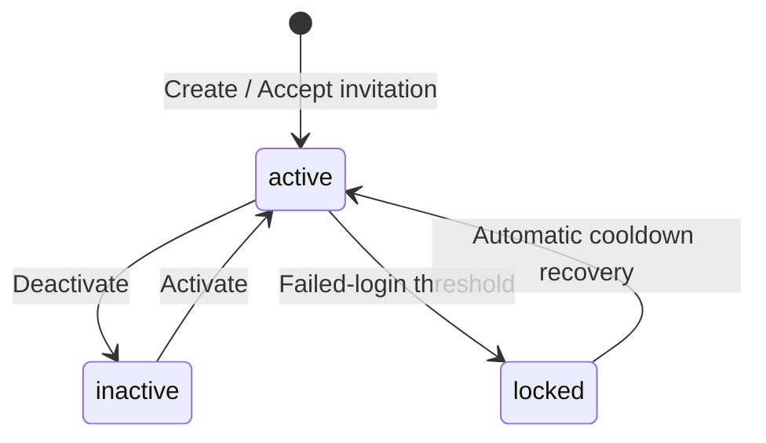

# Users API

Manage users within an organization. Users are the end-user accounts that authenticate through Porta's OIDC endpoints.

**Base path:** `/api/admin/organizations/:orgId/users`

## Create User

```http
POST /api/admin/organizations/:orgId/users
```

| Field          | Type   | Required | Description                               |
| -------------- | ------ | -------- | ----------------------------------------- |
| `email`        | string | ✅       | Email address (must be unique within org) |
| `given_name`   | string |          | First name                                |
| `family_name`  | string |          | Last name                                 |
| `nickname`     | string |          | Nickname                                  |
| `password`     | string |          | Password (NIST SP 800-63B compliant)      |
| `phone_number` | string |          | Phone number                              |
| `locale`       | string |          | User locale (e.g., `en`)                  |
| `picture`      | string |          | Profile picture URL                       |

```json
{
  "email": "alice@example.com",
  "given_name": "Alice",
  "family_name": "Smith",
  "password": "a-secure-password-here"
}
```

**Response:** `201 Created`

## Invite User

```http
POST /api/admin/organizations/:orgId/users/invite
```

**Permission:** `admin:user:invite`

Creates a pending invitation and sends an enhanced invitation email. No account is created at invite time; the recipient's account is created only when they accept the invitation and set a password. Supports optional personal message, role/claim pre-assignment, and inviter tracking. Pre-assigned roles and claims are stored with the invitation and automatically applied on acceptance.

| Field                        | Type   | Required | Description                                                        |
| ---------------------------- | ------ | -------- | ------------------------------------------------------------------ |
| `email`                      | string | ✅       | Email address                                                      |
| `givenName`                  | string |          | First name (OIDC standard claim)                                   |
| `familyName`                 | string |          | Last name (OIDC standard claim)                                    |
| `personalMessage`            | string |          | Personal message from the admin (max 500 chars, included in email) |
| `roles`                      | array  |          | Roles to pre-assign on acceptance                                  |
| `roles[].applicationId`      | uuid   | ✅       | Application the role belongs to                                    |
| `roles[].roleId`             | uuid   | ✅       | Role ID to assign                                                  |
| `claims`                     | array  |          | Custom claim values to pre-assign on acceptance                    |
| `claims[].applicationId`     | uuid   | ✅       | Application the claim belongs to                                   |
| `claims[].claimDefinitionId` | uuid   | ✅       | Claim definition ID                                                |
| `claims[].value`             | any    | ✅       | Claim value                                                        |
| `locale`                     | string |          | Optional invitation language input; normalized for rendering and stored unchanged |

The shipped invitation languages are English (`en`) and formal Dutch (`nl`). Email and preview
use supported explicit input, then organization default, global default and English. Regional
input such as `nl-NL` renders as `nl`; unsupported input falls through that chain. This invitation
field is not a new closed configuration enum.

Valid acceptance pages prefer the recipient's browser language before the stored invitation
locale and those defaults. Stored explicit/null values are preserved on acceptance; display
selection does not rewrite them. See [invitation language selection](../guide/custom-ui.md#invitation-language).

**Response:** `201 Created`. Returns `409 Conflict` when the email already has an account in the organization or a live invitation already exists for it.

```json
{
  "data": {
    "invitationId": "uuid",
    "email": "user@example.com",
    "invitationSent": true,
    "emailDelivery": "sent",
    "expiresAt": "2026-01-08T00:00:00.000Z"
  }
}
```

`emailDelivery` is `sent`, `failed`, or `unknown`. `invitationSent` is true only when the
configured transport accepted the message. A failed or unknown send still creates the invitation
and records an `email.send.failed` audit event.

**Pre-assignment behavior:**

- Referenced applications, roles, and claim definitions are validated at invite time
- Pre-assignments are applied automatically when the invitation is accepted
- If a role or claim is deleted between invitation and acceptance, that assignment is skipped (best-effort)
- A new invitation replaces any live invitation for the same email address

## Tenant-Scoped Invite User

```http
POST /api/organizations/:orgId/users/invite
```

This is the BFF-facing route. It does not require a control-plane administrator.

**Caller authority — exactly one of:**

| Caller         | Token                             | Requirement                                                                                                     |
| -------------- | --------------------------------- | --------------------------------------------------------------------------------------------------------------- |
| Tenant service | `client_credentials` access token | Client is active and confidential, belongs to `:orgId`, and has the registered `org:user:invite` scope          |
| Tenant user    | User access token                 | User is active, belongs to `:orgId`, and has the `org:user:invite` permission in the token client's application |

The request body uses the same fields as the admin invite route, except that
custom claim pre-assignment is not accepted on this route. Additional rules:

- Every pre-assigned role must belong to the token client's application.
- Custom claim pre-assignment is not accepted on this route in this iteration.
- Canonical `porta-admin` roles are rejected.
- A tenant user cannot pre-assign a role whose permissions exceed the user's own permissions.
- The route rejects control-plane clients and the super-admin organization.
- Audit records the tenant user ID or service client ID as the actor.

A successful response has the same `201 Created` shape as the admin route. The
route returns `403` for cross-organization callers or insufficient authority,
and `409` when the email already exists.

The tenant service client must be configured with `clientType: confidential`,
`grantTypes: ['client_credentials']`, `scope: 'org:user:invite'`, and
`tokenEndpointAuthMethod: 'client_secret_post'`. The SDK client-credentials
provider sends the secret in the form body.

## Tenant-Scoped Invitation Revocation

```http
DELETE /api/organizations/:orgId/invitations/:invitationId
```

Cancels one pending invitation before the recipient accepts it. The tenant invite
route returns `invitationId`; keep that value if a later rejection or withdrawal
should prevent account creation.

**Caller authority** is the same as tenant invitation creation: a confidential
service client with `org:user:invite`, or a tenant user with that permission in
the token client's application. Control-plane callers and other organizations
are rejected.

Rules and limitations:

- The invitation must belong to the authenticated tenant application. Ownership
  is recorded when a tenant invitation is created, even without role
  pre-assignment.
- Admin API invitations and invitations created before application ownership
  existed are unowned. They remain valid until acceptance, replacement or expiry,
  but this tenant route does not cancel them.
- Any authorized actor in that application may cancel its pending invitations;
  the operation is not limited to the original inviter.
- Normal completion is `204 No Content` with an empty body. Unknown, already
  used, expired, replaced, foreign-application and unowned identifiers return
  the same empty `204`; existence and prior state are not disclosed through the
  normal status or response body. Timing is not guaranteed to be
  indistinguishable.
- The operation is idempotent. A second request changes nothing and writes no
  second success audit event.
- A committed acceptance is never undone. If acceptance completes first, the
  account remains; if cancellation completes first, acceptance uses the normal
  expired-invitation page and creates no account.
- One durable `user.invite.revoked` audit event records the tenant user or service
  client, organization, invitation and application identifiers. It never stores
  the token, its hash or the recipient address.
- No email or other notification is sent.
- The route shares the strict `org:user:delete` deletion budget: 60 requests per
  hour per authenticated actor and organization, including no-op requests.
  Exceeding it returns `429`; if the counter cannot be enforced, the route
  returns `503` without changing the invitation.
- A malformed invitation UUID returns `400`. Storage or audit failure returns a
  sanitized `500` and leaves the invitation usable.

SDK equivalent:

```typescript
await tenant.users.revokeInvitation({ organizationId, invitationId });
```

The SDK sends a bodyless `DELETE` on a transport configured with
`apiPrefix: '/api'`. The default admin prefix does not gain this authority.
Identifiers that would resolve to a `.` or `..` path segment are rejected
locally before any request, so they can never be normalized onto another route.

## Tenant-Scoped M2M User Management

A tenant service client can manage users in its own organization without a
control-plane administrator. The API mirrors the Admin resource paths under
`/api`, so the existing SDK domains work with `apiPrefix: '/api'`.

**Base path:** `/api/organizations/:orgId/users`

**Client configuration:**

| Field                     | Value                                                                          |
| ------------------------- | ------------------------------------------------------------------------------ |
| `clientType`              | `confidential`                                                                 |
| `grantTypes`              | `['client_credentials']`                                                       |
| `scope`                   | `org:user:read org:user:write org:user:delete` (add `org:user:invite` if used) |
| `tokenEndpointAuthMethod` | `client_secret_post`                                                           |
| `organizationId`          | Tenant organization                                                            |
| `applicationId`           | Tenant application                                                             |

The client must be active, confidential, belong to `:orgId`, and pass the
tenant boundary. Control-plane clients, the super-admin organization, and
foreign organizations are rejected.

| Method   | Path                         | Required scope    | Behavior                                       |
| -------- | ---------------------------- | ----------------- | ---------------------------------------------- |
| `POST`   | `/`                          | `org:user:write`  | Create a user without a password               |
| `GET`    | `/`                          | `org:user:read`   | List users with the Admin pagination contracts |
| `GET`    | `/:userId`                   | `org:user:read`   | Read one user and its ETag                     |
| `PUT`    | `/:userId`                   | `org:user:write`  | Update profile and verification flags          |
| `POST`   | `/:userId/deactivate`        | `org:user:write`  | Active → inactive                              |
| `POST`   | `/:userId/activate`          | `org:user:write`  | Inactive → active                              |
| `DELETE` | `/:userId`                   | `org:user:delete` | Permanently delete the user                    |
| `GET`    | `/:userId/roles`             | `org:user:read`   | Roles from the client application only         |
| `GET`    | `/:userId/roles/permissions` | `org:user:read`   | Effective permissions from that application    |
| `PUT`    | `/:userId/roles`             | `org:user:write`  | Assign roles from that application             |
| `DELETE` | `/:userId/roles`             | `org:user:write`  | Remove roles from that application             |
| `POST`   | `/invite`                    | `org:user:invite` | Existing invite route (service or user actor)  |

**Create and update fields:** full OIDC profile fields plus `emailVerified` and
`phoneNumberVerified`. The tenant create route rejects `password`; the update
route rejects `email`, `status`, `password`, and 2FA fields. A verified phone
requires a non-null phone number. The BFF is asserting the verification flags;
record that trust boundary in the BFF.

**Delete safety:** permanent delete requires the separate `org:user:delete`
scope, revokes sessions and tokens, and cannot be undone. Prefer deactivate for
routine offboarding.

**ETag and errors:** create, single-user read, and update return an ETag.
`If-Match` applies to update and uses the existing Admin `409 Conflict`
response when stale. Duplicate email is `409` on this surface (Admin keeps
`400`). Foreign or missing users return the same `404`.

**Supported SDK methods:** `users.create/list/get/update/deactivate/activate/delete`
and `userRoles.list/assign/remove/getEffectivePermissions`. Password,
verify-email, export, history, and invite-preview remain Admin-only; the tenant
router does not mount them.

**Audit:** mutations write one durable `user.*` row with
`actor_type=client`, `actor_client_id`, `actor_client_name`, and target
`user_id`. Reads write best-effort `user.read` / `user.listed` rows; list
metadata contains filters and result count only, never returned user data.

## Preview Invitation Email

```http
POST /api/admin/organizations/:orgId/users/invite/preview
```

**Permission:** `admin:user:invite`

Renders the invitation email without sending it. Returns the HTML, plain text, and subject line for admin review before sending.

Preview uses the same language selection and copy as sent invitations with matching inputs.
Browser preferences do not affect either email surface; the preview destination uses its existing
placeholder token rather than creating a live invitation.

| Field             | Type   | Required | Description                                    |
| ----------------- | ------ | -------- | ---------------------------------------------- |
| `email`           | string | ✅       | Recipient email (for template personalization) |
| `givenName`       | string |          | First name (OIDC standard claim)               |
| `familyName`      | string |          | Last name (OIDC standard claim)                |
| `personalMessage` | string |          | Personal message to include                    |
| `locale`          | string |          | Locale for rendering                           |

**Response:** `200 OK`

```json
{
  "data": {
    "html": "<html>...</html>",
    "text": "Plain text version...",
    "subject": "John Doe has invited you to Acme Corp"
  }
}
```

## List Users

```http
GET /api/admin/organizations/:orgId/users
```

Supports `page`, `pageSize`, `search`, `status`, `sort`, `order` parameters. Search queries match against email, given name, family name, and nickname.

**Response:** `200 OK` — Paginated user list.

## Get User

```http
GET /api/admin/organizations/:orgId/users/:userId
```

**Response:** `200 OK` — Full user profile.

## Update User

```http
PUT /api/admin/organizations/:orgId/users/:userId
```

Updatable fields: `given_name`, `family_name`, `nickname`, `phone_number`, `locale`, `picture`.

::: info
Email changes are not supported through this endpoint to prevent authentication issues.
:::

**Response:** `200 OK`

## Status Lifecycle

Users have three possible statuses (`UserStatus`): `active`, `inactive`, and
`locked`. Administrators can activate and deactivate users. The server uses
`locked` only for automatic failed-login lockout and cooldown recovery.
Invitation is a pending token flow, not a status and not an account: no user
row exists until the recipient accepts. On acceptance the account is created
`active` and the recipient sets a password.



### Status Transition Endpoints

```http
POST /api/admin/organizations/:orgId/users/:userId/deactivate
POST /api/admin/organizations/:orgId/users/:userId/activate
```

Each returns `204 No Content`.

## Set Password

```http
POST /api/admin/organizations/:orgId/users/:userId/password
```

| Field      | Type   | Required | Description                              |
| ---------- | ------ | -------- | ---------------------------------------- |
| `password` | string | ✅       | New password (NIST SP 800-63B compliant) |

Passwords are hashed with **Argon2id** before storage.

**Response:** `200 OK`

## User Roles

See [Roles & Permissions API](/api/rbac) for user-role assignment endpoints at:

```
/api/admin/organizations/:orgId/users/:userId/roles
```

## User Claims

See [Custom Claims API](/api/custom-claims) for user claim value endpoints.

## User 2FA

Manage two-factor authentication for individual users. All endpoints require the `admin:user:2fa` permission.

### Get 2FA Status

```http
GET /api/admin/organizations/:orgId/users/:userId/two-factor/status
```

**Permission:** `admin:user:read`

Returns the user's current 2FA enrollment status, method, and recovery code count.

**Response (200):**

```json
{
  "enabled": true,
  "method": "email",
  "totpConfigured": false,
  "recoveryCodesRemaining": 10
}
```

| Field                    | Type                            | Description                                |
| ------------------------ | ------------------------------- | ------------------------------------------ |
| `enabled`                | boolean                         | Whether 2FA is currently enabled           |
| `method`                 | `"email"` \| `"totp"` \| `null` | Active 2FA method, null if disabled        |
| `totpConfigured`         | boolean                         | Whether a TOTP authenticator is configured |
| `recoveryCodesRemaining` | number                          | Number of unused recovery codes            |

### Disable 2FA

```http
POST /api/admin/organizations/:orgId/users/:userId/two-factor/disable
```

**Permission:** `admin:user:2fa`

Force-disables 2FA for a user, removing their TOTP configuration and recovery codes. Protected by super-admin guard — cannot disable the super-admin user's 2FA.

**Response (200):**

```json
{ "message": "Two-factor authentication disabled" }
```

**Error responses:**

| Status | Reason                                     |
| ------ | ------------------------------------------ |
| 400    | 2FA is not currently enabled for this user |
| 403    | Target user is the super-admin (protected) |
| 404    | User not found in this organization        |

### Reset 2FA

```http
POST /api/admin/organizations/:orgId/users/:userId/two-factor/reset
```

**Permission:** `admin:user:2fa`

Resets 2FA by disabling it and clearing all enrollment data, forcing the user to re-enroll. Protected by super-admin guard.

**Response (200):**

```json
{ "message": "Two-factor authentication reset" }
```

### Regenerate Recovery Codes

```http
POST /api/admin/organizations/:orgId/users/:userId/two-factor/recovery-codes/regenerate
```

**Permission:** `admin:user:2fa`

Generates a new set of 10 recovery codes, invalidating all previous codes. The new plaintext codes are returned once — they cannot be retrieved again. Protected by super-admin guard.

**Response (200):**

```json
{
  "recoveryCodes": ["A1B2C3D4E5", "F6G7H8I9J0", "..."]
}
```

## Organization 2FA Policy

Manage the organization-level 2FA enforcement policy.

### Get Policy

```http
GET /api/admin/organizations/:orgId/two-factor/policy
```

**Permission:** `admin:org:read`

**Response (200):**

```json
{
  "twoFactorPolicy": "optional"
}
```

### Update Policy

```http
PUT /api/admin/organizations/:orgId/two-factor/policy
```

**Permission:** `admin:org:update`

| Field             | Type   | Required | Description                                                           |
| ----------------- | ------ | -------- | --------------------------------------------------------------------- |
| `twoFactorPolicy` | string | Yes      | One of: `optional`, `required_email`, `required_totp`, `required_any` |

**Response (200):**

```json
{
  "twoFactorPolicy": "required_email"
}
```

### Get 2FA Summary

```http
GET /api/admin/organizations/:orgId/two-factor/summary
```

**Permission:** `admin:org:read`

Returns aggregate 2FA enrollment statistics for the organization.

**Response (200):**

```json
{
  "totalUsers": 50,
  "enabledCount": 35,
  "disabledCount": 15,
  "totpCount": 20,
  "emailCount": 15,
  "complianceRate": 0.7
}
```

| Field            | Type   | Description                                    |
| ---------------- | ------ | ---------------------------------------------- |
| `totalUsers`     | number | Total users in the organization                |
| `enabledCount`   | number | Users with 2FA enabled                         |
| `disabledCount`  | number | Users without 2FA                              |
| `totpCount`      | number | Users using TOTP method                        |
| `emailCount`     | number | Users using email OTP method                   |
| `complianceRate` | number | Ratio of enabled/total (0–1, 4 decimal places) |

## Account Lockout

Porta automatically locks accounts after repeated failed login attempts (default: 5 attempts).
Locked accounts auto-unlock after a cooldown period (default: 15 minutes). Administrators cannot
manually lock or unlock accounts.

Lockout thresholds are configurable via the [System Configuration API](/api/config):

- `account_lockout_threshold` — Number of failed attempts before auto-lock (default: `5`)
- `account_lockout_cooldown_minutes` — Minutes before auto-unlock (default: `15`)

See the [Deployment Guide](/guide/deployment#account-lockout) for full details.

## GDPR Data Export

```http
GET /api/admin/organizations/:orgId/users/:userId/export
```

Exports all personal data for a user as a JSON document (GDPR Article 20 — data portability). The export includes:

- User profile (email, name, phone, locale, etc.)
- Organization membership
- Role assignments (with role names and application context)
- Custom claim values (with claim definitions)
- Audit log entries related to the user
- Two-factor authentication enrollment status
- Active OIDC sessions and grants

**Response:** `200 OK` — JSON document containing all user data.

## Delete User

```http
DELETE /api/admin/organizations/:orgId/users/:userId
```

Permanently deletes the user and owned identity and security data in one database transaction.
Affected server-backed sessions and tokens are revoked. Historical audit entries remain under the
configured audit retention policy and may still identify the deleted user.

**Permission:** `admin:user:delete`

**Response:** `204 No Content`

::: danger Irreversible
Deletion cannot be undone. A control-plane user cannot be deleted when that would leave no other
active user with the exact built-in `porta-super-admin` role.
:::

## Standalone User Routes

In addition to the org-scoped routes above, a set of **standalone user routes** is available at `/api/admin/users/:userId`. These provide direct access to user detail and mutation operations by user ID, without requiring the organization ID in the URL path.

**Base path:** `/api/admin/users/:userId`

These routes support administrative clients that navigate by user ID without an organization slug. They delegate to the same service functions and require the same admin authentication and RBAC permissions as the organization-scoped routes.

### Available Standalone Endpoints

| Method   | Path                    | Description         | Permission       |
| -------- | ----------------------- | ------------------- | ---------------- |
| `GET`    | `/:userId`              | Get user by ID      | `user:read`      |
| `PUT`    | `/:userId`              | Update user profile | `user:update`    |
| `POST`   | `/:userId/deactivate`   | Deactivate user     | `user:lifecycle` |
| `POST`   | `/:userId/activate`     | Activate user       | `user:lifecycle` |
| `POST`   | `/:userId/password`     | Set password        | `user:update`    |
| `DELETE` | `/:userId/password`     | Clear password      | `user:update`    |
| `POST`   | `/:userId/verify-email` | Mark email verified | `user:update`    |
| `GET`    | `/:userId/history`      | Change history      | `user:read`      |

::: tip
The `activate` endpoint performs the `inactive → active` status transition.
:::
